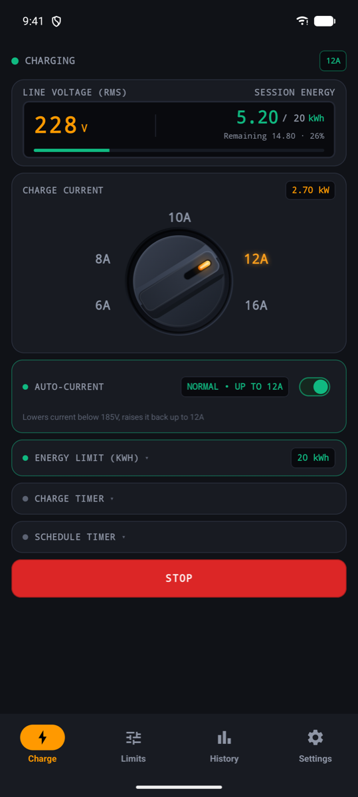
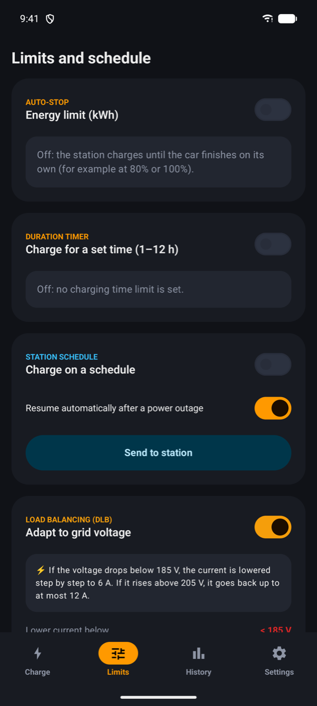
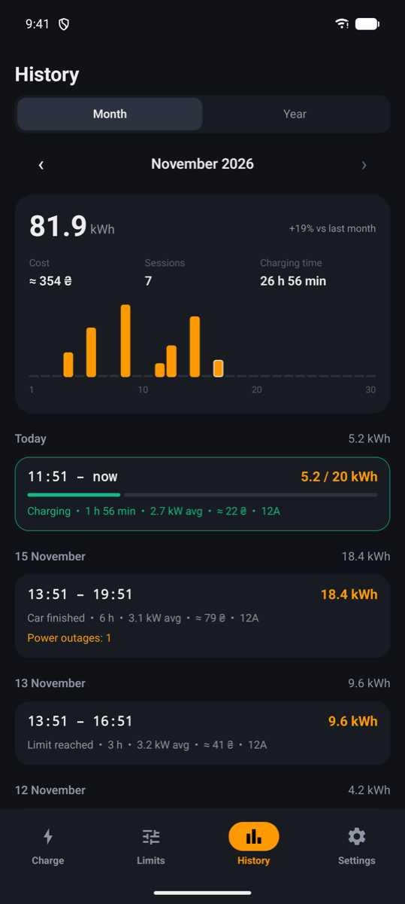
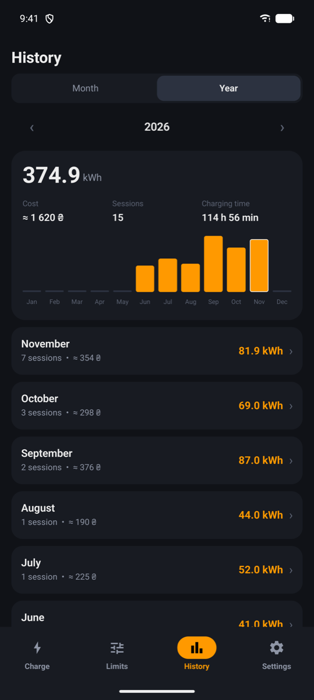
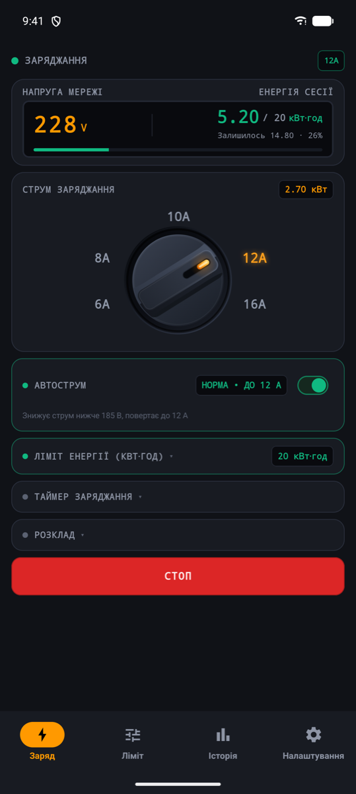
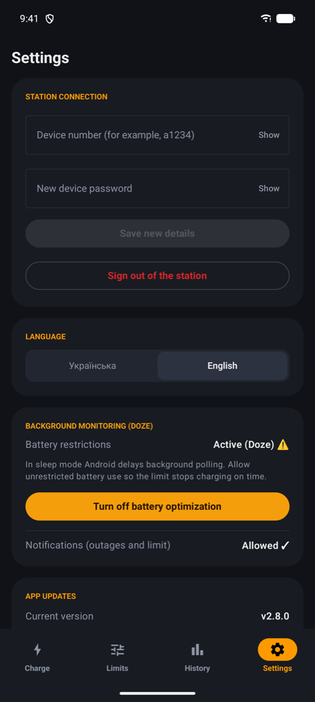
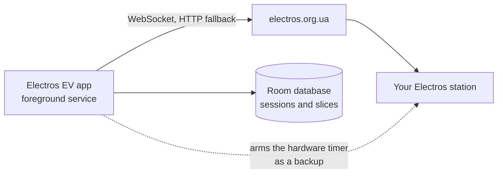

<div align="center">

# ⚡ Electros EV

**Android companion app for Electros home EV charging stations ([electros.org.ua](https://electros.org.ua))**

Charge to an exact kWh limit, ride through blackouts without losing progress, and see what every charge costs.

[](https://github.com/aleksandrtk/electros-app/releases/latest)
[](#requirements)
[](https://kotlinlang.org)
[](https://developer.android.com/compose)

🇺🇦 Українська · 🇬🇧 English

<br>

&nbsp;
&nbsp;
&nbsp;


<sub>Screenshots use demo data.</sub>

</div>

---

## Features

### 🎛️ Live dashboard
- Grid voltage, charging power and session energy, refreshed every 10 seconds.
- A rotary current selector (6–16 A) with weighted, clicky detents.
- The header shows the station state and the current the station is actually delivering right now.

### 🎯 Charge exactly as much as you need
- **Energy limit** from 1 to 100 kWh: the station stops by itself when the target is reached.
- **Charge timer** from 1 to 12 hours: only time spent actually charging is counted.
- **Station schedule**: a daily charging window (for example 23:00–07:00 for a night tariff), written to the station itself.

### 🔌 Built for unstable power
- **Blackout-proof sessions.** Energy delivered before an outage is kept, and the session continues after power returns, automatically or with one tap.
- **Auto-current (DLB).** When the grid voltage sags below a threshold (190 V by default), the current is lowered step by step. When the voltage recovers, it is raised back in two stages: up to 10 A from 200 V, and up to the maximum you set from 205 V.
- **Dead-man safeguard.** While a limited session runs, the station's own hardware timer is armed as a backup, so charging still stops if the phone loses its connection.

### 📊 History and costs
- Month and year views with a bar chart per day or per month.
- Totals for each period: kWh, change against the previous period, number of sessions and charging time.
- Enter your tariff (₴/kWh) once to see the estimated cost of every session, month and year.
- Every session shows its time range, duration, average power, why it ended and any power outages.

### 🔔 Notifications that matter
Power lost or restored, limit or timer reached, current lowered or raised by auto-current, lost connection, and a warning if the station did not confirm a stop.

### 🪵 Wooden style
An optional look for the main screen, switched on in **Settings → Appearance**: walnut and oak boards, a turning wooden selector, engraved lettering and a copper start button. The dark instrument panel stays the default.

### 🌐 Two languages
Ukrainian and English, switchable in **Settings → Language**. On first launch the app picks Ukrainian if the phone is set to Ukrainian or Russian, and English otherwise.

&nbsp;


### 🔄 Updates inside the app
New versions are fetched from GitHub Releases. Before installing, the app checks that the APK is signed with the same key as the installed app.

## How it works



- A foreground service polls the station every 10 seconds while a session is active (every 60 seconds during a blackout), so limits keep working with the screen off.
- Each session is stored as a series of **slices** of the station's energy counter. A blackout or a station reboot closes the current slice and opens a new one, so no energy is lost or counted twice.

## Install

1. Download the latest `electros-app-vX.Y.Z.apk` from [**Releases**](https://github.com/aleksandrtk/electros-app/releases/latest).
2. Open it on your phone and allow installing apps from this source when Android asks.
3. Sign in with your station's device number and password, the same ones you use on electros.org.ua.

Later updates arrive inside the app: **Settings → Check for updates**.

> [!TIP]
> For limits to stop on time, allow the app to run without battery restrictions: **Settings → Turn off battery optimization**.

## Requirements

- Android 17 or newer.
- An Electros charging station connected to electros.org.ua.

## Privacy and security

- Your station number and password are stored only on the phone, encrypted with a key in the Android Keystore (AES-GCM), and excluded from cloud backups.
- The app talks only to `electros.org.ua` (your station) and `github.com` (update checks). There are no analytics or ads.
- Update APKs are downloaded only from GitHub, and are installed only if their signing certificate matches the installed app.

## Built with

| Area | Technology |
|---|---|
| UI | Jetpack Compose, Material 3, edge-to-edge, predictive back |
| Architecture | MVVM with separate domain, data and UI layers |
| Storage | Room (sessions and slices), DataStore, Android Keystore |
| Background work | Coroutine-based foreground service, boot recovery |
| Networking | OkHttp WebSocket, Jsoup for the HTTP fallback |

## Build from source

```bash
git clone https://github.com/aleksandrtk/electros-app.git
cd electros-app
./gradlew test            # unit tests
./gradlew assembleDebug   # app/build/outputs/apk/debug/app-debug.apk
```

<details>
<summary><b>Release signing (maintainers)</b></summary>

Releases are signed with the Electros release key using APK Signature Scheme v3 with key rotation
(lineage: old debug key → release key), so installs signed with the old debug key keep updating.

- One-time setup: `scripts/create-release-keystore.sh` creates `~/.electros-signing/electros-release.p12`
  and the rotation lineage, and stores the password in the macOS Keychain (`electros-release-keystore`).
  **Back up `~/.electros-signing/` and the password**: without them no further updates can be signed.
- Each release: `scripts/sign-release.sh [out.apk]` builds `assembleRelease` unsigned (without access to the key password)
  and signs it with the release key plus the lineage (v3 only; the debug keystore is no longer needed).
- Do not sign releases with `ELECTROS_KEYSTORE` alone: an APK signed by the release key without the lineage
  is rejected as an update by installs that are still on the debug key.

</details>

## License

MIT
