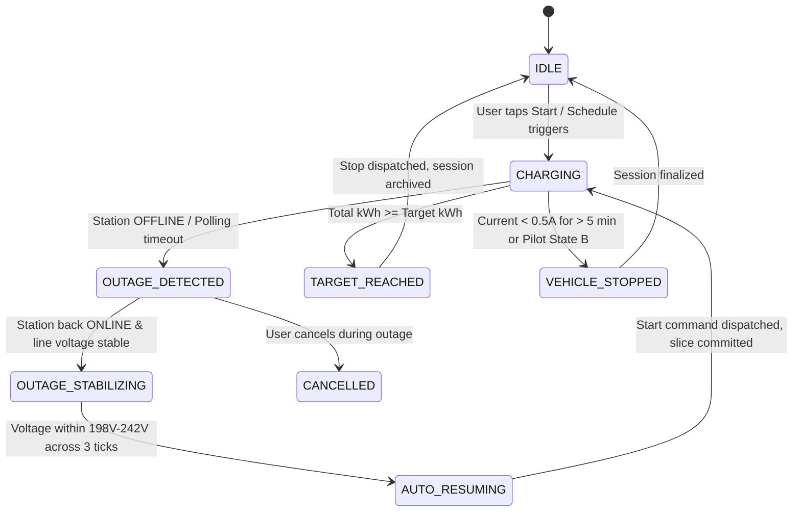

# Electros EV Android Client & Smart Limiter

* **Author:** Oleksandr Tkachuk
* **Status:** Approved
* **Date:** 2026-11-10

---

## Overview

The Electros EV Android Client is a native mobile application built with Jetpack Compose and Material 3 Expressive guidelines. It interfaces with the Electros charging station portal at `https://electros.org.ua/auth/main.php`. It eliminates mobile web browser session management for EV drivers and introduces an automated energy cutoff limiter (for example, stopping charging after delivering exactly 30 kWh).

The application is tailored for garage environments subject to frequent grid power outages. When power drops, the station hardware resets its internal live session energy register to zero upon reboot. The Android client manages an application-scoped Room database energy ledger accessed and updated by an Android Foreground Service, tracks delivered energy slices across multiple power failures, and automatically issues station start commands when grid electricity returns until the designated quota is fulfilled.

## The Problem

Drivers charging electric vehicles via Electros stations face several practical barriers:
1. Telemetry monitoring, current adjustment (6A–32A), and starting/stopping charging require logging into an unoptimized PHP web portal in a mobile browser on every session.
2. The station hardware lacks kilowatt-hour quota controls; it supports only manual start/stop or a wall-clock timestamp scheduler. Drivers wanting to charge a specific volume must manually calculate duration and monitor elapsed charging.
3. In residential and cooperative garages, power blackouts frequently disrupt charging. When power restores, the station boots into a zeroed active energy counter (`0.0 кВт⋅год`), breaking ongoing quota calculations.

## Goals

* Provide an Android native Material 3 interface displaying real-time power, line voltage, neutral voltage, current, and accumulated energy.
* Allow instantaneous current adjustment between 6A and 32A via stepped pilot signal commands.
* Implement a background energy limiter supporting preset quotas (e.g., +10, +20, +30, +50 kWh) and custom numeric limits.
* Maintain a persistent Room database ledger tracking charge slices across power cuts, automatically resuming charge on grid recovery until the total target kilowatt-hour limit is delivered.
* Implement an intuitive schedule timer (start time / stop time) replacing the web portal's raw timestamp inputs.
* Deliver local Android system notifications for station offline events, power restorations, and quota completion.

## Non-Goals

* Hardware-level line voltage delay interlocks (garage electrical infrastructure has hardware RCD/breaker protection; vehicle onboard BMS manages electrical termination natively).
* Direct local Wi-Fi / socket connections to the charger hardware (the charger operates in a remote garage behind a router and communicates solely through `electros.org.ua:8000`).
* Standalone cloud backend server deployment (all state persistence, session tracking, and automation run locally on the driver's Android device).

## Critical User Journeys (CUJs)

### CUJ 1: Target Energy Charging with Garage Power Cut Recovery
* **Given**: Driver connects the EV in the garage, opens the Android app, sets a quota of 30 kWh at 16A, and taps "Почати".
* **When**: After delivering 12.4 kWh, grid electricity drops for 40 minutes, causing the station to report `OFFLINE` and wipe its internal counter upon reboot.
* **Then**: The Android Foreground Service detects the outage, commits the 12.4 kWh slice to the Room database, sends an offline notification to the driver, and polls for station recovery. When power restores and the station reports `ONLINE`, the service automatically sends "Почати", tracks the remaining 17.6 kWh in a second slice, and sends "Зупинити" when total accumulated energy reaches 30.0 kWh.

### CUJ 2: Real-time Telemetry & Dynamic Current Regulation
* **Given**: Vehicle is charging at 10A, delivering 2.2 kW.
* **When**: Driver opens the app and selects 16A on the segmented selector.
* **Then**: The app dispatches the updated amperage command to `electros.org.ua`, updates the pilot signal, and updates telemetry metrics (power increases to 3.7 kW, current reads 16.0A) within 3 seconds.

### CUJ 3: Scraper Session Expiration and Automatic Re-login
* **Given**: Background service is monitoring an active charging session overnight when the server-side PHP session cookie expires.
* **When**: The next telemetry HTTP GET request receives a redirect to `https://electros.org.ua/auth/login.php`.
* **Then**: The scraper detects the authentication redirect, intercepts the response, executes an automated POST login request with encrypted credentials stored in `AuthPreferences`, updates the session cookie in `CookieStorage`, and transparently resumes telemetry polling without missing quota tracking ticks.

### CUJ 4: Quota Target Reached with Stop Dispatch Retry Escalation
* **Given**: Delivered energy reaches the configured 30.0 kWh target, triggering the `TARGET_REACHED` transition.
* **When**: The service dispatches `action=stop`, but encounters a cellular socket timeout or HTTP 503 error.
* **Then**: The service acquires an immediate CPU wake lock, escalates retry cadence to every 2 seconds with a 3-attempt budget, and displays an urgent high-priority heads-up notification alerting the driver if all network retries fail.

---

## Technical Plan (Architecture)

### 1. High-Level Modular Architecture

The application adopts Clean Architecture with unidirectional data flow (MVI) across four core modules:

```text
+-------------------------------------------------------------+
|                     Presentation Layer                      |
|  - MainActivity: Entry point and Compose Scaffold           |
|  - Jetpack Compose UI (Material 3 Expressive, Dark Theme)   |
|  - ViewModels: Dashboard, Limiter, History, Settings        |
+-------------------------------------------------------------+
                              | (State & Events)
+-------------------------------------------------------------+
|                        Domain Layer                         |
|  - ChargingStateMachine: Manages operational lifecycle     |
|  - EnergyAccumulator: Multi-slice kilowatt-hour ledger      |
|  - Use Cases: StartCharge, StopCharge, SetAmperage, Schedule |
+-------------------------------------------------------------+
                              |
+-------------------------------------------------------------+
|                     Data & Service Layer                    |
|  - ChargeRepository: Coordinates network and Room storage   |
|  - ChargeMonitorService (Foreground Service, specialUse)    |
|  - ReconciliationWorker (WorkManager reboot recovery)       |
|  - Room Database: ChargeSessionEntity, ChargeSliceEntity    |
|  - Network Scraper: OkHttp3 + PersistentCookieJar + Jsoup   |
|  - AuthPreferences: EncryptedSharedPreferences via Keystore |
+-------------------------------------------------------------+
                              | HTTPS
+-------------------------------------------------------------+
|              Cloud Web Portal (electros.org.ua)             |
+-------------------------------------------------------------+
```

### 2. Operational State Machine



### 3. Energy Accumulator Mechanics Across Blackouts

When an electrical blackout strikes the garage, the station microcontroller shuts down immediately. Upon reboot, the station's internal counter resets to `0.0 кВт⋅год`.

To preserve continuity:
1. The local Room database records charging as an aggregate `ChargeSession` composed of 1..N `ChargeSlice` entries.
2. When the background service detects an outage (telemetry failure or `OFFLINE` status), it immediately finalizes the active `ChargeSlice` with its last known monotonic kilowatt-hour reading:
   $$\text{Slice Delivered} = \text{Last Sampled kWh} - \text{Slice Start kWh}$$
3. **Monotonic Counter Regression Guard**: If the station reboots rapidly before an explicit `OFFLINE` status is sampled, the scraper may observe a sudden counter drop ($\text{Current Reading} < \text{Last Sampled Reading}$). When detected, `EnergyAccumulator` implicitly finalizes the active slice using `Last Sampled Reading`, creates a new slice anchored at $\text{Current Reading}$, and records the outage recovery without corrupting session totals.
4. Total delivered energy is calculated as:
   $$\text{Total kWh} = \sum_{i=1}^{N-1} \text{FinalizedSlice}_i + (\text{ActiveStationCounter} - \text{ActiveSliceStart})$$
5. Once the station re-establishes connectivity with `electros.org.ua` and completes stabilization, the service verifies:
   $$\text{Remaining Quota} = \text{Target kWh} - \text{Total Delivered kWh}$$
   If $\text{Remaining Quota} > 0.1\text{ kWh}$, the service dispatches the `Почати` command, creates $\text{ChargeSlice}_{N+1}$, and resumes polling.
6. **Dead-Man Hardware Backup**: When starting or resuming charge slices, the service synchronizes the station's hardware timer (`timer_stop`) calculated as expected duration plus a 15-minute buffer ($\Delta t = \text{Remaining kWh} / \text{Power} + 15\text{ min}$). If the mobile client disconnects, the station automatically terminates charging.

### 4. Room Database Schema

#### `ChargeSessionEntity`
* `id: String` (UUID, Primary Key)
* `targetKwh: Double` (Configured quota, e.g. 30.0)
* `amperageSetting: Int` (e.g. 16)
* `status: SessionStatus` (`CHARGING`, `OUTAGE_PAUSED`, `COMPLETED`, `CANCELLED`)
* `startedAt: Long` (Epoch millis)
* `completedAt: Long?` (Epoch millis)
* `totalKwhDelivered: Double`

#### `ChargeSliceEntity`
* `id: Long` (Auto-generated Primary Key)
* `sessionId: String` (Foreign Key referencing `ChargeSessionEntity.id`)
* `sliceIndex: Int` (0, 1, 2...)
* `stationCounterStartKwh: Double` (Usually 0.0 upon reboot)
* `stationCounterLastKwh: Double`
* `finalizedKwh: Double`
* `startedAt: Long`
* `endedAt: Long?`
* `terminationReason: SliceEndReason` (`POWER_OUTAGE`, `TARGET_REACHED`, `MANUAL_STOP`, `VEHICLE_STOPPED`)

### 5. Web Scraping & Network Transport Layer

* **Polling Cadence & Rate Limits:**
  * Active charging: Poll every 10 seconds.
  * Outage detected / station offline: Poll every 60 seconds.
  * Idle / unplugged: Zero background polling.
  * Rate-limit backoff: Exponential backoff (10s -> 20s -> 40s -> 80s) on HTTP 429 or 503 responses.
* **Security & Session Lifecycle:**
  * Transport Security: Enforces HTTPS for all endpoints with strict TLS 1.3/1.2 validation.
  * Credential Storage: Credentials stored in `AuthPreferences` utilizing `EncryptedSharedPreferences` backed by Android Keystore.
  * Anti-CSRF Token Handling: On every command dispatch, `ElectrosWebScraper` parses hidden form inputs (`csrf_token` / `auth_token`) from the latest `main.php` DOM before dispatching POST payloads.
  * Authentication Circuit Breaker: Limits automated re-login to 2 consecutive retries before halting polling and prompting the driver.
* **Telemetry Parser (Jsoup):**
  * Voltage metrics: Parses Grid Voltage table (`Min`, `Середня`, `Поточна`, `Max`).
  * Neutral metrics: Parses Neutral Voltage table.
  * Station Status: Extracts `Станція ONLINE` / `Станція OFFLINE` badge text.
  * Energy & Power: Extracts values from `.energy-display` (`Спожита енергія`, `Потужність`).
  * Active Current: Extracts `Струм, виміряний: X.X A`.
* **Action Dispatcher:**
  * Start: POST request with parameter `action=start`.
  * Stop: POST request with parameter `action=stop`.
  * Set Current: POST request with parameter `current={value}`.
  * Set Timer: POST request with parameters `timer_start={HH:MM}` and `timer_stop={HH:MM}`.

### 6. Android Background Service & Notification Strategy

* **Service Type:** Declared as `foregroundServiceType="specialUse"` with `<property android:name="android.app.PROPERTY_SPECIAL_USE_FGS_SUBTYPE" android:value="ev_charging_session_monitor" />` complying with Android 14 and 15 foreground service policies.
* **Continuous Execution & Wake Lock:** While charging is active, `ChargeMonitorService` executes a Kotlin coroutine loop with `delay(10_000)` and holds a `PowerManager.PARTIAL_WAKE_LOCK` strictly across active network requests, retaining CPU execution without relying on throttled AlarmManager loops.
* **Notification Channel:** High-importance channel `charging_status` updating live:
  * Content: Current power (`3.7 кВт`), delivered energy vs quota (`18.4 / 30.0 кВт⋅год`), status (`Charging at 16A`).
  * Actions: `[Зупинити]` action button configured with `PendingIntent.FLAG_IMMUTABLE` requiring device unlock authentication to prevent unauthorized tampering.

---

## Alternatives Considered

### Alternative A: Dedicated Server / Home Assistant Daemon
* **Pros**: Eliminates mobile battery saver termination risks; runs 24/7 on a home server or Raspberry Pi.
* **Cons**: Introduces server hardware costs, deployment overhead, and ongoing network maintenance.
* **Reason for Rejection**: Running and maintaining an extra server daemon is excessive overhead for personal vehicle charging; an Android application with a Foreground Service satisfies automation goals self-sufficiently without external infrastructure.

### Alternative B: In-Memory Kilowatt-Hour Counting without Room DB
* **Pros**: Simpler codebase without Room database entities, DAOs, or SQLite schema management.
* **Cons**: Loses all accumulated slice metrics if the Android operating system terminates the process during deep sleep or low memory, causing unmonitored overcharging.
* **Reason for Rejection**: Volatile in-memory accounting fails to guarantee quota limits across multi-hour overnight sessions and device restarts.

### Alternative C: Synthetic 45-Second Voltage Stabilization Delay
* **Pros**: Waits for line voltage transients to settle following cold grid restoration.
* **Cons**: Introduces fragile software delay states and timer failure modes.
* **Reason for Rejection**: Garage electrical infrastructure already contains a hardware RCD (УЗО) and circuit breakers; hardware protection handles physical transients safely without software complexity.

### Alternative D: Software Battery-Full Heuristic Polling
* **Pros**: Detects vehicle BMS cutoff independently from the station.
* **Cons**: Redundant polling logic and risk of false-positive session cancellations.
* **Reason for Rejection**: The Electros station and the vehicle BMS automatically terminate charging upon reaching target percentage, and persistent zero current confirms termination without synthetic heuristics.

---

## Detailed Implementation Plan

### 1. Unified Task Checklist

1. Project Setup & Build Configuration:
   * Create root `build.gradle.kts` and `settings.gradle.kts`.
   * Configure `app/build.gradle.kts` applying Kotlin 2.0, `org.jetbrains.kotlin.plugin.compose`, Compose BOM, Room 2.6, OkHttp 4.12, Jsoup 1.17, WorkManager 2.9, and Security-Crypto.
   * Configure `AndroidManifest.xml` with `INTERNET`, `FOREGROUND_SERVICE`, `FOREGROUND_SERVICE_SPECIAL_USE`, `WAKE_LOCK`, `POST_NOTIFICATIONS`, `RECEIVE_BOOT_COMPLETED`, and register `MainActivity`, `ElectrosApplication`, `ChargeMonitorService`, and `BootReceiver`.
2. Application Entry Points:
   * Implement `ElectrosApplication` to initialize dependency graphs, Room singleton, and notification channels.
   * Implement `MainActivity` as `ComponentActivity` setting content to `AppNavigation`.
3. Data Layer - Networking & Scraping:
   * Implement `CookieStorage` to persist PHP session cookies.
   * Implement `AuthPreferences` with `EncryptedSharedPreferences` for station credentials.
   * Build `ElectrosWebScraper` for authentication, HTML DOM parsing, CSRF extraction, and action POST dispatching.
4. Data Layer - Persistence:
   * Implement `Converters` for Room enum serialization.
   * Create Room entities `ChargeSessionEntity` and `ChargeSliceEntity`.
   * Implement `ChargeDao` with atomic transaction methods.
   * Construct `AppDatabase` singleton.
5. Data Layer - Repository:
   * Build `ChargeRepository` coordinating network calls, Room slice operations, and telemetry StateFlow streams.
6. Domain Layer:
   * Implement `EnergyAccumulator` pure calculation logic with counter regression protection.
   * Build `ChargingStateMachine` handling lifecycle transitions and auto-resumes.
7. Background Execution & Recovery:
   * Implement `ChargeMonitorService` as an Android Foreground Service with `specialUse` type and coroutine loop.
   * Implement `NotificationHelper` with secure action buttons (`Stop`, `Pause`).
   * Implement `BootReceiver` and `ReconciliationWorker` for reboot recovery.
8. Presentation Layer (Jetpack Compose UI):
   * Build design system in `ui/theme/` (Material 3 Dark Theme tokens, Typography, Shapes).
   * Implement `DashboardViewModel`, `LimiterViewModel`, `HistoryViewModel`, and `SettingsViewModel`.
   * Implement `DashboardScreen` (radial progress dial with SVG glow, live telemetry grid, segmented amperage buttons 6A–32A).
   * Implement `LimiterScreen` (energy quota stepper + preset chips, smart time scheduler).
   * Implement `HistoryScreen` (monthly consumption cards, session list).
   * Implement `SettingsScreen` (station constants, grounding toggles, battery optimization whitelist helper).
   * Implement `AppNavigation` (M3 Navigation Bar with vector SVG icons and pill indicators).
9. Verification & Unit Testing:
   * Unit tests for `EnergyAccumulatorTest` validating slice aggregation and regression handling.
   * Unit tests for `ElectrosWebScraperTest` parsing mock HTML tables and status spans.
   * Unit tests for `ChargingStateMachineTest` validating transitions and timeout triggers.

### 2. File-by-File Inventory

| Target File Path | Change Type | Rationale & Responsibilities |
| :--- | :--- | :--- |
| `build.gradle.kts` | Create | Root build script declaring Kotlin and Android Gradle plugin versions. |
| `settings.gradle.kts` | Create | Project settings configuring plugin repositories and including `:app` module. |
| `app/build.gradle.kts` | Create | Declares Kotlin 2.0, Compose compiler plugin, Compose BOM, Room 2.6, OkHttp 4.12, Jsoup 1.17, WorkManager 2.9, and Security-Crypto. |
| `app/src/main/AndroidManifest.xml` | Create | Declares permissions (`INTERNET`, `FOREGROUND_SERVICE`, `FOREGROUND_SERVICE_SPECIAL_USE`, `WAKE_LOCK`, `POST_NOTIFICATIONS`, `RECEIVE_BOOT_COMPLETED`), registers `MainActivity`, `ElectrosApplication`, `ChargeMonitorService`, and `BootReceiver`. |
| `app/src/main/java/ua/org/electros/app/ElectrosApplication.kt` | Create | Application class initializing Room database, notification channels, and global dependencies. |
| `app/src/main/java/ua/org/electros/app/MainActivity.kt` | Create | Main launcher activity hosting Compose `AppNavigation` scaffold. |
| `app/src/main/java/ua/org/electros/app/data/model/TelemetryData.kt` | Create | Pure data classes for line voltage (min/avg/current/max), neutral voltage, current, power, and station status. |
| `app/src/main/java/ua/org/electros/app/data/model/StationConfig.kt` | Create | Domain models for station hardware parameters (grounding, leakage, min voltage, Wi-Fi credentials). |
| `app/src/main/java/ua/org/electros/app/data/network/CookieStorage.kt` | Create | Implements OkHttp `CookieJar` backed by encrypted local storage to preserve PHP session state across app restarts. |
| `app/src/main/java/ua/org/electros/app/data/local/AuthPreferences.kt` | Create | Wrapper around `EncryptedSharedPreferences` for station credentials and auth tokens. |
| `app/src/main/java/ua/org/electros/app/data/network/ElectrosWebScraper.kt` | Create | Handles HTTP authentication, scraping of telemetry tables via Jsoup, CSRF extraction, and dispatch of start/stop/amperage POST commands. |
| `app/src/main/java/ua/org/electros/app/data/local/Converters.kt` | Create | Room `@TypeConverters` for `SessionStatus` and `SliceEndReason` enum serialization. |
| `app/src/main/java/ua/org/electros/app/data/local/entity/ChargeSessionEntity.kt` | Create | Room table tracking macro charging sessions, target limits, and aggregated energy. |
| `app/src/main/java/ua/org/electros/app/data/local/entity/ChargeSliceEntity.kt` | Create | Room table recording individual post-outage charge slices with starting and ending counter readings. |
| `app/src/main/java/ua/org/electros/app/data/local/dao/ChargeDao.kt` | Create | DAO methods providing atomic queries and transactions to commit slices on power drop. |
| `app/src/main/java/ua/org/electros/app/data/local/AppDatabase.kt` | Create | Room Database singleton registering entities and type converters. |
| `app/src/main/java/ua/org/electros/app/data/repository/ChargeRepository.kt` | Create | Repository layer exposing unified telemetry flows and coordinating Room transactions with network operations. |
| `app/src/main/java/ua/org/electros/app/domain/accumulator/EnergyAccumulator.kt` | Create | Mathematical engine computing aggregate delivered kilowatt-hours and remaining quota across slices with counter regression guard. |
| `app/src/main/java/ua/org/electros/app/domain/statemachine/ChargingStateMachine.kt` | Create | State machine executing transitions (`IDLE`, `CHARGING`, `OUTAGE_DETECTED`, `OUTAGE_STABILIZING`, `AUTO_RESUMING`, `TARGET_REACHED`, `VEHICLE_STOPPED`). |
| `app/src/main/java/ua/org/electros/app/service/ChargeMonitorService.kt` | Create | Android Foreground Service (`specialUse`) executing coroutine polling loop with partial wake lock. |
| `app/src/main/java/ua/org/electros/app/service/NotificationHelper.kt` | Create | Manages notification channels, ongoing lock screen charging progress notifications, and secure action button intents. |
| `app/src/main/java/ua/org/electros/app/service/BootReceiver.kt` | Create | BroadcastReceiver triggered by `BOOT_COMPLETED` enqueuing reconciliation work. |
| `app/src/main/java/ua/org/electros/app/service/ReconciliationWorker.kt` | Create | WorkManager CoroutineWorker reconciling incomplete charge sessions in Room upon device restart. |
| `app/src/main/java/ua/org/electros/app/ui/theme/Color.kt` | Create | Defines Material 3 dark palette tokens mapped to MaterialTheme ColorScheme roles. |
| `app/src/main/java/ua/org/electros/app/ui/theme/Theme.kt` | Create | Configures MaterialTheme with dark color scheme and dynamic contrast. |
| `app/src/main/java/ua/org/electros/app/ui/dashboard/DashboardViewModel.kt` | Create | MVI ViewModel exposing StateFlow for live metrics and processing driver actions. |
| `app/src/main/java/ua/org/electros/app/ui/dashboard/DashboardScreen.kt` | Create | Compose screen implementing the hero gauge, live telemetry grid, segmented amperage selector, and action buttons. |
| `app/src/main/java/ua/org/electros/app/ui/limiter/LimiterViewModel.kt` | Create | ViewModel managing energy quota presets, custom limit inputs, and night tariff schedules. |
| `app/src/main/java/ua/org/electros/app/ui/limiter/LimiterScreen.kt` | Create | Compose screen for energy quota selection (+10, +20, +30, +50 kWh chips) and schedule time picker. |
| `app/src/main/java/ua/org/electros/app/ui/history/HistoryViewModel.kt` | Create | ViewModel loading historical sessions and monthly consumption statistics from Room. |
| `app/src/main/java/ua/org/electros/app/ui/history/HistoryScreen.kt` | Create | Compose screen rendering monthly consumption statistics and historical session logs. |
| `app/src/main/java/ua/org/electros/app/ui/settings/SettingsViewModel.kt` | Create | ViewModel managing station hardware parameters and battery optimization whitelist status. |
| `app/src/main/java/ua/org/electros/app/ui/settings/SettingsScreen.kt` | Create | Compose screen for station hardware parameters, calibration constants, and OEM battery optimization exemption prompts. |
| `app/src/main/java/ua/org/electros/app/ui/navigation/AppNavigation.kt` | Create | Scaffold implementing 80dp M3 Navigation Bar with vector SVG icons and pill indicators. |
| `app/src/test/java/ua/org/electros/app/domain/EnergyAccumulatorTest.kt` | Create | Unit test validating mathematical accuracy of slice aggregation across zeroed counter reboots and regressions. |
| `app/src/test/java/ua/org/electros/app/domain/ChargingStateMachineTest.kt` | Create | Unit test validating state transitions, timeout triggers, stabilization gates, and auto-resume execution. |
| `app/src/test/java/ua/org/electros/app/data/ElectrosWebScraperTest.kt` | Create | Unit test validating Jsoup extraction against mock HTML payloads of `electros.org.ua/auth/main.php`. |
